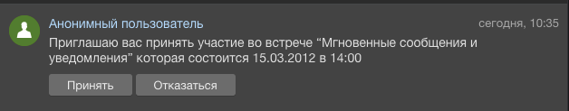

# Взаимодействовать с кнопками уведомлений im.notify.confirm



Выберите инструмент для разработки с AI-агентом:

- используйте [Битрикс24 Вайбкод](../../../ai-tools/vibecode.md), чтобы создать приложение для Битрикс24 по описанию задачи без знания языков программирования. Агент напишет код и разместит приложение на сервере без ручной настройки хостинга
- используйте [MCP-сервер](../../../ai-tools/mcp.md), чтобы разрабатывать интеграцию через REST API в своем проекте. Агент будет обращаться к официальной REST-документации



> Scope: [`im`](../../scopes/permissions.md)
>
> Кто может выполнять метод: любой пользователь

Метод `im.notify.confirm` нажимает кнопку в уведомлении текущего пользователя и удаляет это уведомление.



Уведомления с кнопками создают модули Битрикс24, например приглашения на встречу в календаре. Методы [im.notify.personal.add](./im-notify-personal-add.md) и [im.notify.system.add](./im-notify-system-add.md) такие уведомления не создают



## Параметры метода



#|
|| **Название**
`тип` | **Описание** ||
|| **NOTIFY_ID***
[`integer`](../../data-types.md) | Идентификатор уведомления с кнопками. Получить идентификатор можно методом [im.notify.get](./im-notify-get.md), у таких уведомлений поле `notify_type` равно `1`.

Вместо `NOTIFY_ID` можно передать параметр `ID`. Если переданы оба, метод использует `ID` ||
|| **NOTIFY_VALUE***
[`string`](../../data-types.md) | Значение выбранной кнопки. Значения задает модуль, который отправил уведомление.

Например, у уведомления с кнопками «Принять» и «Отказаться» значения `Y` и `N`.

Строку `0` метод считает пустым значением и возвращает ошибку `NOTIFY_VALUE_ERROR` ||
|#



## Примеры кода





- cURL (Webhook)

    ```bash
    curl -X POST \
      -H "Content-Type: application/json" \
      -H "Accept: application/json" \
      -d '{"NOTIFY_ID":288,"NOTIFY_VALUE":"Y"}' \
      https://**put_your_bitrix24_address**/rest/**put_your_user_id_here**/**put_your_webhook_here**/im.notify.confirm
    ```

- cURL (OAuth)

    ```bash
    curl -X POST \
      -H "Content-Type: application/json" \
      -H "Accept: application/json" \
      -d '{"NOTIFY_ID":288,"NOTIFY_VALUE":"Y","auth":"**put_access_token_here**"}' \
      https://**put_your_bitrix24_address**/rest/im.notify.confirm
    ```

- JS (TS)

    ```ts
    // This snippet is an ES module: top-level await requires type="module" or a bundler.
    // $b24 is an already-initialized SDK instance (see the SDK "Get started" guide).
    import { Text } from '@bitrix24/b24jssdk'
    import type { B24Frame } from '@bitrix24/b24jssdk'

    declare const $b24: B24Frame

    // Shape of the payload returned in result (match the "response handling" section of the page)
    type NotifyConfirmResult = {
      result_message: string[] | false
    }

    try {
      const response = await $b24.actions.v2.call.make<NotifyConfirmResult>({
        method: 'im.notify.confirm',
        params: {
          NOTIFY_ID: 288,
          NOTIFY_VALUE: 'Y',
        },
        requestId: Text.getUuidRfc4122()
      })

      // The payload is available only on a successful response
      if (!response.isSuccess) {
        console.error(response.getErrorMessages().join('; '))
      } else {
        const result = response.getData()!.result
        console.info(result.result_message)
      }
    } catch (error) {
      // Thrown on transport or SDK failures (AjaxError, SdkError, etc.)
      console.error(error)
    }
    ```

- JS (UMD)

    ```html
    <!-- Load the SDK (UMD build); it is exposed as the global B24Js -->
    <script src="https://unpkg.com/@bitrix24/b24jssdk@1/dist/umd/index.min.js"></script>
    <script>
      async function confirmNotification() {
        try {
          // Initialize the SDK inside a Bitrix24 frame
          const $b24 = await B24Js.initializeB24Frame()

          const response = await $b24.actions.v2.call.make({
            method: 'im.notify.confirm',
            params: {
              NOTIFY_ID: 288,
              NOTIFY_VALUE: 'Y',
            },
            requestId: B24Js.Text.getUuidRfc4122()
          })

          // The payload is available only on a successful response
          if (!response.isSuccess) {
            console.error(response.getErrorMessages().join('; '))
            return
          }

          const result = response.getData().result
          console.info(result.result_message)
        } catch (error) {
          // Thrown on transport or SDK failures (AjaxError, SdkError, etc.)
          console.error(error)
        }
      }

      document.addEventListener('DOMContentLoaded', confirmNotification)
    </script>
    ```

- Python

    ```python
    from b24pysdk.errors import BitrixAPIError, BitrixSDKException

    try:
        bitrix_response = client.im.notify.confirm(
            notify_id=288,
            notify_value=True,
        ).response
        result = bitrix_response.result
        print(result)
    except BitrixAPIError as error:
        print(
            "Ошибка Bitrix API",
            f"error: {error.error}",
            f"error_description: {error.error_description}",
            sep="\n",
        )
    except BitrixSDKException as error:
        print(f"Ошибка Bitrix SDK: {error.message}")
    except Exception as error:
        print(f"Непредвиденная ошибка: {error}")
    ```

- PHP

    ```php
    try {
        $response = $b24Service->core->call(
            'im.notify.confirm',
            [
                'NOTIFY_ID' => 288,
                'NOTIFY_VALUE' => 'Y',
            ]
        );

        $result = $response->getResponseData()->getResult();

        print_r($result);
    } catch (Throwable $exception) {
        echo $exception->getMessage();
    }
    ```

- BX24.js

    ```js
    BX24.callMethod(
        'im.notify.confirm',
        {
            NOTIFY_ID: 288,
            NOTIFY_VALUE: 'Y',
        },
        function(result) {
            if (result.error()) {
                console.error(result.error().ex);
            } else {
                console.log(result.data());
            }
        }
    );
    ```

- PHP CRest

    ```php
    require_once('crest.php');

    $result = CRest::call(
        'im.notify.confirm',
        [
            'NOTIFY_ID' => 288,
            'NOTIFY_VALUE' => 'Y',
        ]
    );

    if (!empty($result['error'])) {
        echo 'Error: ' . $result['error_description'];
    } else {
        var_dump($result['result']);
    }
    ```

- Go

    ```go
    // client и ctx уже созданы — см. раздел «SDK для Go»
    res, err := client.Core().Call(ctx, "im.notify.confirm", b24.Params{
    	"NOTIFY_ID":    288,
    	"NOTIFY_VALUE": "Y",
    })
    if err != nil {
    	return fmt.Errorf("im.notify.confirm: %w", err)
    }

    // Метод заворачивает ответ в объект с ключом "result_message".
    raw, ok := b24.Unwrap(res.Result, "result_message")
    if !ok {
    	return fmt.Errorf("в ответе нет ключа result_message")
    }

    fmt.Printf("%s\n", raw)
    ```



## Обработка ответа

HTTP-статус: **200**

```json
{
    "result": {
        "result_message": [
            "Вы выбрали пункт \"Принять\""
        ]
    },
    "time": {
        "start": 1794317487,
        "finish": 1794317487.750427,
        "duration": 0.7504270076751709,
        "processing": 0,
        "date_start": "2026-11-10T16:31:27+03:00",
        "date_finish": "2026-11-10T16:31:27+03:00",
        "operating_reset_at": 1794318060,
        "operating": 0
    }
}
```

Если уведомление не найдено среди уведомлений текущего пользователя или у него нет кнопок, метод возвращает HTTP-статус **200** и `false` в поле `result_message`:

```json
{
    "result": {
        "result_message": false
    },
    "time": {
        "start": 1794317487,
        "finish": 1794317487.750427,
        "duration": 0.7504270076751709,
        "processing": 0,
        "date_start": "2026-11-10T16:31:27+03:00",
        "date_finish": "2026-11-10T16:31:27+03:00",
        "operating_reset_at": 1794318060,
        "operating": 0
    }
}
```

### Возвращаемые данные

#|
|| **Название**
`тип` | **Описание** ||
|| **result**
[`object`](../../data-types.md) | Объект с результатом нажатия кнопки [(подробное описание)](#result-object) ||
|| **time**
[`time`](../../data-types.md#time) | Информация о времени выполнения запроса ||
|#

#### Объект result {#result-object}

#|
|| **Название**
`тип` | **Описание** ||
|| **result_message**
[`array`](../../data-types.md)
[`boolean`](../../data-types.md) | Результат нажатия кнопки:
- массив строк — сообщения модуля, который обработал нажатие. Если модуль не вернул сообщение, массив содержит текст `Вы выбрали пункт "<название кнопки>"`. Если значение `NOTIFY_VALUE` не совпало ни с одной кнопкой, массив может быть пустым
- `false` — уведомление с указанным идентификатором не найдено среди уведомлений текущего пользователя или у уведомления нет кнопок

После нажатия кнопки уведомление удаляется, даже если массив пустой ||
|#

## Обработка ошибок

HTTP-статус: **400**

```json
{
    "error": "NOTIFY_VALUE_ERROR",
    "error_description": "Notification Value can't be empty"
}
```



### Возможные коды ошибок

#|
|| **Статус** | **Код** | **Описание** | **Значение** ||
|| `400` | `ID_ERROR` | Notification ID can't be empty | Параметры `NOTIFY_ID` и `ID` не переданы или значение меньше или равно `0` ||
|| `400` | `NOTIFY_VALUE_ERROR` | Notification Value  can't be empty | Параметр `NOTIFY_VALUE` не передан, пустой или равен строке `0` ||
|#



## Продолжите изучение

- [{#T}](./im-notify.md)
- [{#T}](./im-notify-personal-add.md)
- [{#T}](./im-notify-system-add.md)
- [{#T}](./im-notify-get.md)
- [{#T}](./im-notify-schema-get.md)
- [{#T}](./im-notify-read-list.md)
- [{#T}](./im-notify-read.md)
- [{#T}](./im-notify-read-all.md)
- [{#T}](./im-notify-answer.md)
- [{#T}](./im-notify-delete.md)
- [{#T}](./im-notify-history-search.md)
