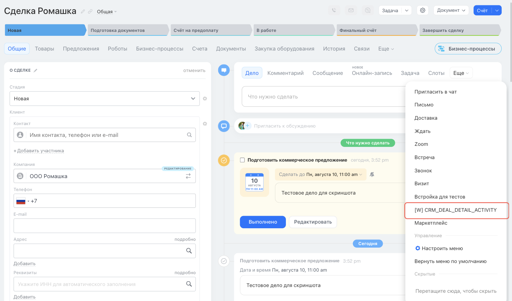

# Кнопка над таймлайном карточки элемента CRM_XXX_DETAIL_ACTIVITY, CRM_DYNAMIC_XXX_DETAIL_ACTIVITY



Выберите инструмент для разработки с AI-агентом:

- используйте [Битрикс24 Вайбкод](../../../ai-tools/vibecode.md), чтобы создать приложение для Битрикс24 по описанию задачи без знания языков программирования. Агент напишет код и разместит приложение на сервере без ручной настройки хостинга
- используйте [MCP-сервер](../../../ai-tools/mcp.md), чтобы разрабатывать интеграцию через REST API в своем проекте. Агент будет обращаться к официальной REST-документации



> Scope: [`placement, crm`](../../scopes/permissions.md)

Виджет добавляет свою кнопку в панель над таймлайном карточки объекта CRM: [лида](../../crm/leads/index.md), [контакта](../../crm/contacts/index.md), [компании](../../crm/companies/index.md), [сделки](../../crm/deals/index.md), [коммерческого предложения](../../crm/quote/index.md), [нового счета](../../crm/universal/invoice.md), [заказа](../../sale/order/index.md) или [пользовательского типа объектов](../../crm/universal/index.md).

Код точки встраивания указывается в параметре `PLACEMENT` метода [placement.bind](../placement-bind.md).



Виджет не отображается в интерфейсе, пока установка приложения не завершена. [Проверьте установку приложения](../../../settings/app-installation/installation-finish.md)



## Как работает точка

1. Приложение регистрирует обработчик методом [placement.bind](../placement-bind.md), передав в `PLACEMENT` код из [таблицы](#codes). Метод работает только от имени приложения, через вебхук точку не зарегистрировать. Зарегистрировать виджет может администратор или сотрудник с правом создавать приложения
2. В меню *Еще* над таймлайном появляется пункт приложения
3. Пользователь нажимает пункт: по умолчанию Битрикс24 открывает обработчик во фрейме в слайдере. При `OPTIONS.useBuiltInInterface = 'Y'` обработчик загружается в скрытом фрейме и вызывает `setLayout`, передавая [структуру интерфейса](./detail-activity-area.md#LayoutDto). Битрикс24 отображает интерфейс по этой структуре. Контекст вызова описан в разделе [Что получает обработчик](#handler-data)
4. Обработчик использует идентификатор объекта из `PLACEMENT_OPTIONS` для получения данных через REST с токеном `AUTH_ID` текущего пользователя

## Когда использовать

Точка подходит для действий рядом с делами и комментариями. Например:

- открыть форму регистрации обращения во внешней системе
- подготовить сообщение клиенту на основе данных сделки

Выбирайте обычный слайдер для собственной верстки приложения, встроенный интерфейс — для формы на основе структуры интерфейса. Для постоянного просмотра связанных данных используйте [вкладку карточки](./detail-tab.md), для действия в верхнем меню — [пункт меню карточки](./detail-toolbar.md).

## Куда встраивается виджет {#codes}

#|
|| **Код точки встраивания** | **Место** ||
|| `CRM_LEAD_DETAIL_ACTIVITY` | Кнопка над таймлайном [лида](../../crm/leads/index.md) ||
|| `CRM_CONTACT_DETAIL_ACTIVITY` | Кнопка над таймлайном [контакта](../../crm/contacts/index.md) ||
|| `CRM_COMPANY_DETAIL_ACTIVITY` | Кнопка над таймлайном [компании](../../crm/companies/index.md) ||
|| `CRM_DEAL_DETAIL_ACTIVITY` | Кнопка над таймлайном [сделки](../../crm/deals/index.md) ||
|| `CRM_QUOTE_DETAIL_ACTIVITY` | Кнопка над таймлайном [коммерческого предложения](../../crm/quote/index.md) ||
|| `CRM_SMART_INVOICE_DETAIL_ACTIVITY` | Кнопка над таймлайном [нового счета](../../crm/universal/invoice.md) ||
|| `CRM_ORDER_DETAIL_ACTIVITY` | Кнопка над таймлайном [заказа интернет-магазина](../../sale/order/index.md) ||
|| `CRM_DYNAMIC_XXX_DETAIL_ACTIVITY` | Кнопка над таймлайном пользовательского типа объектов CRM. Вместо XXX необходимо указывать числовой идентификатор конкретного [пользовательского типа объектов](../../crm/universal/index.md). Например, `CRM_DYNAMIC_183_DETAIL_ACTIVITY` ||
|#

### Где находится в интерфейсе

Откройте карточку объекта CRM и нажмите *Еще* в панели над таймлайном — в ряду кнопок *Дело*, *Комментарий*, *Сообщение*. Пункт приложения выводится в этом меню.

В режиме только чтения нажатие пункта приложения не открывает виджет.



## Что получает обработчик {#handler-data}

Данные передаются POST-запросом: часть параметров — в query-строке адреса обработчика, остальные — в теле запроса {.b24-info}

Пример показан для обычного открытия слайдера в точке `CRM_DEAL_DETAIL_ACTIVITY`. Встроенный интерфейс получает другой набор ключей `PLACEMENT_OPTIONS`, описанный ниже.

```php

Array
(
    [DOMAIN] => xxx.bitrix24.com
    [PROTOCOL] => 1
    [LANG] => ru
    [APP_SID] => 79adf5ce0f12cdb9e4137fd8ea6741bf
    [AUTH_ID] => a15e7166007e9c94001e30ba00000001f0f1073c7d9e0512b8a46f0ed37c951
    [AUTH_EXPIRES] => 3600
    [REFRESH_ID] => 904d9966007e9c94001e30ba00000001f0f10748e2b1d3906f57ca2b81de640
    [SERVER_ENDPOINT] => https://oauth.bitrix24.tech/rest/
    [APPLICATION_TOKEN] => ec1b2074a9d3f5c81b6e40d27a95cf38
    [APPLICATION_SCOPE] => crm,placement
    [member_id] => d897063e1ce7c5eb9f04b9751eef5915
    [status] => L
    [PLACEMENT] => CRM_DEAL_DETAIL_ACTIVITY
    [PLACEMENT_OPTIONS] => {"ID":"8061","URI":"\/crm\/deal\/details\/8061\/?any=details%2F8061%2F"}
)

```





### PLACEMENT_OPTIONS

Значение `PLACEMENT_OPTIONS` передается как JSON-строка. При обычном открытии слайдера передается `ID`, при `useBuiltInInterface = 'Y'` — `entityTypeId`, `entityId` и `useBuiltInInterface = 'Y'`.

#|
|| **Параметр** | **Описание** ||
|| **ID**
[`string`](../../data-types.md) | Идентификатор объекта CRM или заказа при обычном открытии слайдера.

Для лида, сделки, контакта, компании, коммерческого предложения, нового счета или элемента пользовательского типа используйте [crm.item.get](../../crm/universal/crm-item-get.md), указав `entityTypeId` и `id`.

Для заказа используйте [sale.order.get](../../sale/order/sale-order-get.md), указав `id`. Для вызова `sale.*` приложению нужен scope `sale`.

При обычном открытии слайдера идентификатор типа объекта отдельным ключом не приходит. Для пользовательского типа объектов его можно взять из значения параметра `PLACEMENT`: например, у кода `CRM_DYNAMIC_183_DETAIL_ACTIVITY` идентификатор типа равен `183`

||
|| **entityTypeId**
[`integer`](../../data-types.md) | Идентификатор [типа объекта CRM](../../crm/data-types.md#object_type) или заказа. Передается во встроенном интерфейсе ||
|| **entityId**
[`integer`](../../data-types.md) | Идентификатор объекта CRM или заказа. Передается во встроенном интерфейсе; данные объекта можно получить теми же методами, что и для `ID` ||
|| **useBuiltInInterface**
[`string`](../../data-types.md) | Признак встроенного интерфейса. Передается со значением `Y` в этом режиме ||
|#

По нажатию на *Подробнее* в приветственном уведомлении открывается отдельный слайдер: его контекст содержит `entityTypeId`, `entityId`, `newUserNotification = 'Y'` и `bx24_width = 800`.

## OPTIONS при регистрации через placement.bind

Для точек `CRM_XXX_DETAIL_ACTIVITY` метод `placement.bind` поддерживает параметры `OPTIONS`. Они включают штатный интерфейс Битрикс24 вместо собственной верстки приложения и настраивают приветственное уведомление.

#|
|| **Параметр**
`тип` | **Описание** ||
|| **useBuiltInInterface**
[`string`](../../data-types.md) | Использовать стандартный интерфейс Битрикс24: `Y` — включить, `N` — выключить. По умолчанию `N`. При `Y` интерфейс строится по [структуре интерфейса](./detail-activity-area.md#LayoutDto) ||
|| **newUserNotificationTitle**
[`string`](../../data-types.md) | Заголовок уведомления для нового пользователя ||
|| **newUserNotificationText**
[`string`](../../data-types.md) | Текст уведомления для нового пользователя ||
|#

Для показа уведомления укажите непустые заголовок и текст. Уведомление показывается пользователю, который еще его не просмотрел, в сохраненной карточке, если показ уведомлений не отключен и кнопка доступна в интерфейсе.

## Примеры кода





- cURL (OAuth)

    ```bash
    curl -X POST \
      -H "Content-Type: application/json" \
      -H "Accept: application/json" \
      -d '{
        "PLACEMENT": "CRM_DEAL_DETAIL_ACTIVITY",
        "HANDLER": "https://your-domain.com/widgets/crm-detail-activity-handler.php",
        "TITLE": "Моя кнопка над таймлайном",
        "LANG_ALL": {
          "ru": {
            "TITLE": "Моя кнопка над таймлайном"
          },
          "en": {
            "TITLE": "My timeline button"
          }
        },
        "OPTIONS": {
          "useBuiltInInterface": "Y",
          "newUserNotificationTitle": "Встречайте новое приложение",
          "newUserNotificationText": "Приложение поможет работать со сделками"
        },
        "auth": "**put_access_token_here**"
      }' \
      https://**put_your_bitrix24_address**/rest/placement.bind
    ```

- JS (TS)

    ```ts
    // This snippet is an ES module: top-level await requires type="module" or a bundler.
    // $b24 is an already-initialized SDK instance (see the SDK "Get started" guide).
    import { Text } from '@bitrix24/b24jssdk'
    import type { B24Frame } from '@bitrix24/b24jssdk'

    declare const $b24: B24Frame

    try {
      const response = await $b24.actions.v2.call.make<boolean>({
        method: 'placement.bind',
        params: {
          PLACEMENT: 'CRM_DEAL_DETAIL_ACTIVITY',
          HANDLER: 'https://your-domain.com/widgets/crm-detail-activity-handler.php',
          TITLE: 'Моя кнопка над таймлайном',
          LANG_ALL: {
            ru: {
              TITLE: 'Моя кнопка над таймлайном',
            },
            en: {
              TITLE: 'My timeline button',
            },
          },
          OPTIONS: {
            useBuiltInInterface: 'Y',
            newUserNotificationTitle: 'Встречайте новое приложение',
            newUserNotificationText: 'Приложение поможет работать со сделками',
          },
        },
        requestId: Text.getUuidRfc4122()
      })

      // The payload is available only on a successful response
      if (!response.isSuccess) {
        console.error(response.getErrorMessages().join('; '))
      } else {
        const result = response.getData()!.result
        console.info('Placement bound successfully:', result)
      }
    } catch (error) {
      // Thrown on transport or SDK failures (AjaxError, SdkError, etc.)
      console.error(error)
    }
    ```

- JS (UMD)

    ```html
    <!-- Load the SDK (UMD build); it is exposed as the global B24Js -->
    <script src="https://unpkg.com/@bitrix24/b24jssdk@1/dist/umd/index.min.js"></script>
    <script>
      async function bindCrmDealDetailActivity() {
        try {
          // Initialize the SDK inside a Bitrix24 frame
          const $b24 = await B24Js.initializeB24Frame()

          const response = await $b24.actions.v2.call.make({
            method: 'placement.bind',
            params: {
              PLACEMENT: 'CRM_DEAL_DETAIL_ACTIVITY',
              HANDLER: 'https://your-domain.com/widgets/crm-detail-activity-handler.php',
              TITLE: 'Моя кнопка над таймлайном',
              LANG_ALL: {
                ru: {
                  TITLE: 'Моя кнопка над таймлайном',
                },
                en: {
                  TITLE: 'My timeline button',
                },
              },
              OPTIONS: {
                useBuiltInInterface: 'Y',
                newUserNotificationTitle: 'Встречайте новое приложение',
                newUserNotificationText: 'Приложение поможет работать со сделками',
              },
            },
            requestId: B24Js.Text.getUuidRfc4122()
          })

          // The payload is available only on a successful response
          if (!response.isSuccess) {
            console.error(response.getErrorMessages().join('; '))
            return
          }

          const result = response.getData().result
          console.info('Placement bound successfully:', result)
        } catch (error) {
          // Thrown on transport or SDK failures (AjaxError, SdkError, etc.)
          console.error(error)
        }
      }

      document.addEventListener('DOMContentLoaded', bindCrmDealDetailActivity)
    </script>
    ```

- PHP

    ```php
    try {
        $response = $b24Service
            ->core
            ->call(
                'placement.bind',
                [
                    'PLACEMENT' => 'CRM_DEAL_DETAIL_ACTIVITY',
                    'HANDLER' => 'https://your-domain.com/widgets/crm-detail-activity-handler.php',
                    'TITLE' => 'Моя кнопка над таймлайном',
                    'LANG_ALL' => [
                        'ru' => [
                            'TITLE' => 'Моя кнопка над таймлайном',
                        ],
                        'en' => [
                            'TITLE' => 'My timeline button',
                        ],
                    ],
                    'OPTIONS' => [
                        'useBuiltInInterface' => 'Y',
                        'newUserNotificationTitle' => 'Встречайте новое приложение',
                        'newUserNotificationText' => 'Приложение поможет работать со сделками',
                    ],
                ]
            );

        $result = $response->getResponseData()->getResult();

        print_r($result);
    } catch (Throwable $e) {
        echo $e->getMessage();
    }
    ```

- BX24.js

    ```js
    BX24.callMethod(
        'placement.bind',
        {
            PLACEMENT: 'CRM_DEAL_DETAIL_ACTIVITY',
            HANDLER: 'https://your-domain.com/widgets/crm-detail-activity-handler.php',
            TITLE: 'Моя кнопка над таймлайном',
            LANG_ALL: {
                ru: { TITLE: 'Моя кнопка над таймлайном' },
                en: { TITLE: 'My timeline button' }
            },
            OPTIONS: {
                useBuiltInInterface: 'Y',
                newUserNotificationTitle: 'Встречайте новое приложение',
                newUserNotificationText: 'Приложение поможет работать со сделками'
            }
        },
        function(result) {
            if (result.error()) {
                console.error(result.error());
            } else {
                console.log(result.data());
            }
        }
    );
    ```

- PHP CRest

    ```php
    require_once('crest.php');

    $result = CRest::call(
        'placement.bind',
        [
            'PLACEMENT' => 'CRM_DEAL_DETAIL_ACTIVITY',
            'HANDLER' => 'https://your-domain.com/widgets/crm-detail-activity-handler.php',
            'TITLE' => 'Моя кнопка над таймлайном',
            'LANG_ALL' => [
                'ru' => [
                    'TITLE' => 'Моя кнопка над таймлайном',
                ],
                'en' => [
                    'TITLE' => 'My timeline button',
                ],
            ],
            'OPTIONS' => [
                'useBuiltInInterface' => 'Y',
                'newUserNotificationTitle' => 'Встречайте новое приложение',
                'newUserNotificationText' => 'Приложение поможет работать со сделками',
            ],
        ]
    );

    echo '<PRE>';
    print_r($result);
    echo '</PRE>';
    ```

- Go

    ```go
    // client и ctx уже созданы — см. раздел «SDK для Go»
    res, err := client.Core().Call(ctx, "placement.bind", b24.Params{
    	"PLACEMENT": "CRM_DEAL_DETAIL_ACTIVITY",
    	"HANDLER":   "https://your-domain.com/widgets/crm-detail-activity-handler.php",
    	"TITLE":     "Моя кнопка над таймлайном",
    	"LANG_ALL": b24.Params{
    		"ru": b24.Params{
    			"TITLE": "Моя кнопка над таймлайном",
    		},
    		"en": b24.Params{
    			"TITLE": "My timeline button",
    		},
    	},
    	"OPTIONS": b24.Params{
    		"useBuiltInInterface":      "Y",
    		"newUserNotificationTitle": "Встречайте новое приложение",
    		"newUserNotificationText":  "Приложение поможет работать со сделками",
    	},
    })
    if err != nil {
    	return fmt.Errorf("placement.bind: %w", err)
    }

    // Ответ приходит как json.RawMessage — разберите его по форме ответа
    // метода placement.bind, см. раздел «Обработка ответа» на его странице.
    fmt.Printf("%s\n", res.Result)
    ```



## Типовые ошибки

Ошибки регистрации и способы их устранения описаны на странице [placement.bind](../placement-bind.md).

## Продолжите изучение

- [{#T}](./index.md)
- [{#T}](./detail-activity-area.md)
- [{#T}](../placement-bind.md)
- [{#T}](../ui-interaction/index.md)
- [{#T}](../../../settings/interactivity/index.md)
- [{#T}](../bx24-widget-methods.md)

