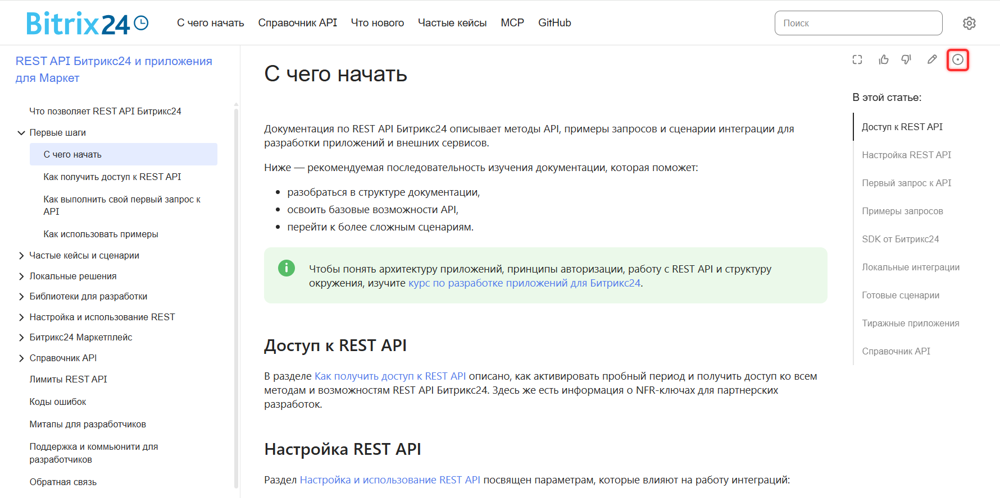
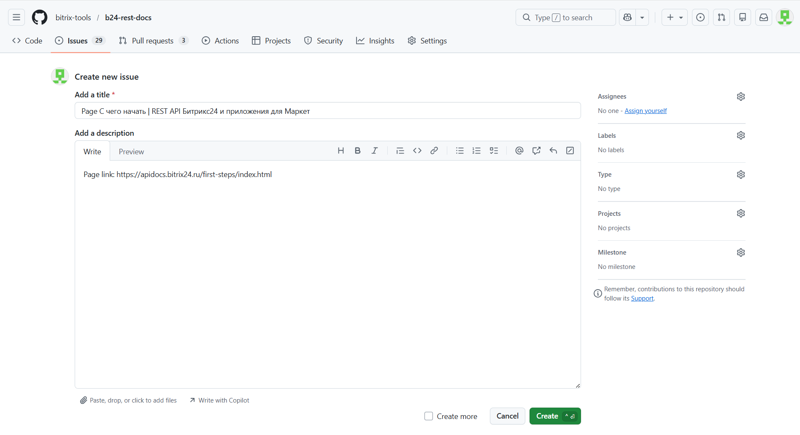
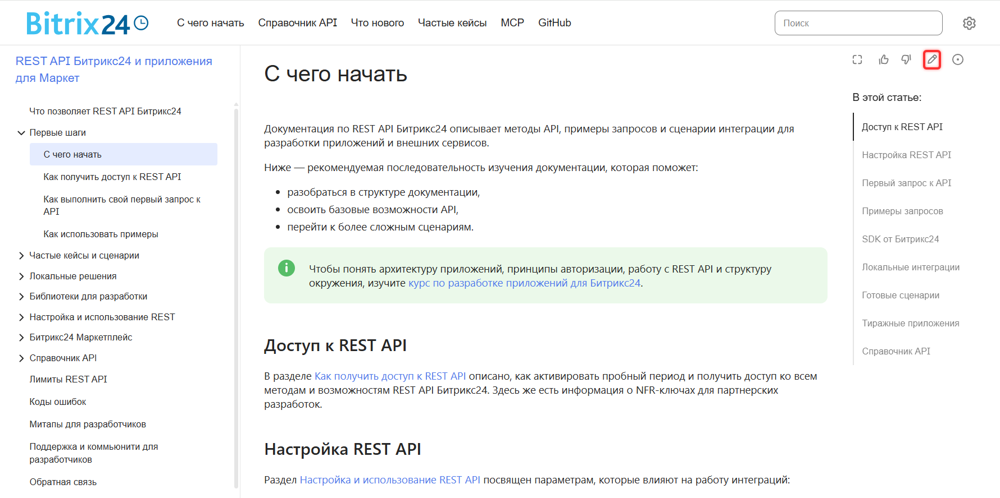
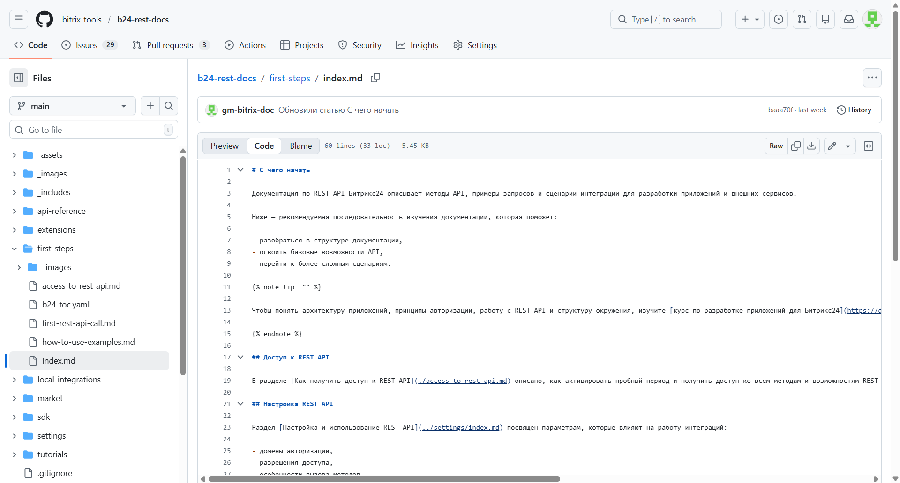

# Обратная связь

Документация REST API Битрикс24 находится в открытом репозитории на [GitHub](https://github.com/bitrix-tools/b24-rest-docs). Если вы нашли ошибку в статье, хотите исправить материал или добавить новый, напишите нам. Мы внимательно относимся к предложениям и стараемся отвечать быстро.

На этой странице описано, как сообщить об ошибке в документации, предложить правку или новую статью через GitHub. Вопросы о работе методов, ошибках API и настройке интеграций решает поддержка и комьюнити — используйте каналы со страницы [{#T}](./support.md) или напишите в [техническую поддержку](./bitrix-support.md).

## Как выбрать способ

| Задача | Способ | Что потребуется |
|---|---|---|
| Сообщить об ошибке в статье или задать вопрос по тексту документации | [Issue](#issue) | Аккаунт GitHub |
| Исправить или дополнить существующую статью | [Pull Request](#pull-request) | Аккаунт GitHub, копия репозитория — Fork |
| Добавить статью, которой нет в документации | [Новая статья](#new-article) | Аккаунт GitHub, копия репозитория — Fork, знание Markdown |

## Как устроена документация

Документация хранится в GitHub в виде файлов в формате Markdown и YAML. Итоговые HTML-страницы генерируются автоматически после того, как редакторы примут изменения.

- Статья — файл `.md` в папке раздела
- Меню раздела — файл `b24-toc.yaml` в той же папке
- Основная ветка репозитория — `main`. В нее вносят изменения только редакторы
- Остальные участники работают в своей копии репозитория — Fork — и предлагают изменения через Pull Request

## Как заполнить форму Issue или Pull Request {#form}

Форма Issue и форма Pull Request содержат одинаковые поля:

- *Add a title* — заголовок. Коротко назовите проблему или изменение
- *Add a description* — описание. Подробно опишите проблему, вопрос или правку и объясните причину

| Что вы отправляете | Add a title | Add a description |
|---|---|---|
| Issue со страницы документации | Подставляется название статьи, его можно оставить | Подставляется ссылка на статью. Ниже опишите проблему или вопрос |
| Issue из репозитория | Суть проблемы, например «Неверный тип параметра в crm.deal.add» | Ссылка на статью, описание проблемы и ожидаемый вариант |
| Pull Request с правкой | Суть изменения | Что изменили и почему |
| Pull Request с новой статьей | Имя добавленного файла | Тема статьи и причина, по которой ее стоит добавить |

## Как оставить Issue {#issue}

Issue подходит, если вы заметили ошибку в статье или хотите задать вопрос по тексту документации.

### Со страницы документации

1. Откройте нужную статью и нажмите на иконку круга с точкой в верхней части страницы.

   

2. Вы перейдете в репозиторий GitHub. Форма Issue откроется автоматически.

   

3. Заполните [форму](#form).
4. Нажмите *Create*.

### Из репозитория GitHub

1. Откройте [репозиторий документации](https://github.com/bitrix-tools/b24-rest-docs).
2. В верхнем меню выберите вкладку *Issues* и нажмите *New issue*.
3. Заполните [форму](#form).
4. Нажмите *Create*.

## Как отправить Pull Request {#pull-request}

Pull Request подходит, если вы хотите исправить или улучшить существующую статью.

### Со страницы документации

1. Откройте нужную статью и нажмите на иконку карандаша в верхней части страницы.

   

2. Вы перейдете в репозиторий GitHub. Откроется файл статьи, которую вы планируете изменить.

   

3. В правом верхнем углу нажмите на иконку карандаша. GitHub предложит создать Fork — подтвердите.
4. Внесите изменения прямо в интерфейсе и нажмите *Commit changes*.
5. GitHub предложит создать Pull Request — подтвердите.
6. Заполните [форму](#form).
7. Нажмите *Create pull request*.

### Из репозитория GitHub

1. Откройте [репозиторий документации](https://github.com/bitrix-tools/b24-rest-docs).
2. В правом верхнем углу нажмите *Fork* и создайте копию репозитория.
3. В копии найдите нужный файл, внесите изменения и нажмите *Commit changes*.
4. В верхнем меню репозитория выберите вкладку *Pull requests* и нажмите *New pull request*.
5. Заполните [форму](#form).
6. Нажмите *Create pull request*.

## Как предложить новую статью {#new-article}

Новая статья состоит из двух изменений: файла статьи и пункта меню в `b24-toc.yaml` того же раздела. Без пункта меню статья не появится в навигации.

1. Откройте [репозиторий документации](https://github.com/bitrix-tools/b24-rest-docs).
2. Перейдите в папку раздела, куда хотите добавить статью.
3. В правом верхнем углу нажмите *Add file > Create new file*.
4. Укажите имя файла с расширением `.md`.
5. Напишите текст статьи в формате Markdown и нажмите *Commit changes*.
6. В той же папке откройте файл `b24-toc.yaml` и добавьте пункт меню по примеру:

   ```yaml
   - name: Как получить доступ к REST API
     href: access-to-rest-api.md
   ```

   - `name` — название пункта меню. Для статей о методах и событиях указывайте только описание действия. Например, для статьи «Создать новую сделку crm.deal.add» пункт меню — «Создать новую сделку»
   - `href` — имя файла статьи

7. Нажмите *Commit changes*.
8. GitHub предложит создать Pull Request — подтвердите.
9. Заполните [форму](#form).
10. Нажмите *Create pull request*.

## Что происходит после отправки

Редакторы документации получают уведомление об Issue или Pull Request. Ответ и вопросы по правке появятся в комментариях на GitHub, уведомления придут на почту аккаунта GitHub. После того как редакторы примут Pull Request, изменения появятся на сайте документации при следующей сборке.

## Продолжите изучение

- [{#T}](./support.md)
- [{#T}](./bitrix-support.md)
- [{#T}](./error-codes.md)
- [{#T}](./tutorials/index.md)
