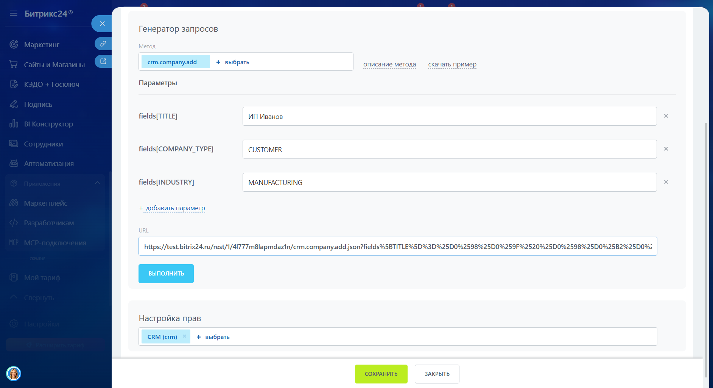
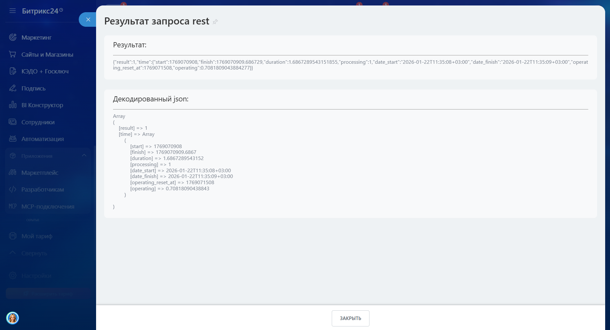
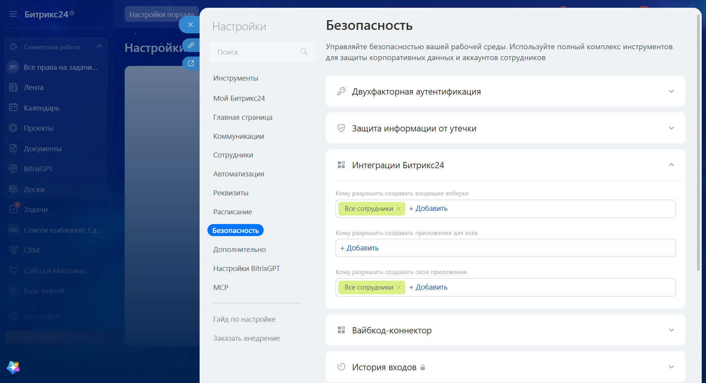

# Как выполнить свой первый запрос к API



Выберите инструмент для разработки с AI-агентом:

- используйте [Битрикс24 Вайбкод](../ai-tools/vibecode.md), чтобы создать приложение для Битрикс24 по описанию задачи без знания языков программирования. Агент напишет код и разместит приложение на сервере без ручной настройки хостинга
- используйте [MCP-сервер](../ai-tools/mcp.md), чтобы разрабатывать интеграцию через REST API в своем проекте. Агент будет обращаться к официальной REST-документации



Чтобы выполнить первый запрос к REST API, создайте входящий вебхук. Это готовый инструмент для вызова методов API с правами пользователя, который создал вебхук.

Проверить вебхук можно методом [profile](../api-reference/common/users/profile.md): он ничего не меняет в Битрикс24 и возвращает ваши данные — имя, фамилию и ID. Если запрос не пройдет, причину подскажет код ошибки. Когда вебхук заработает, выберите способ авторизации для рабочей интеграции: вебхук или приложение.

## Как создать входящий вебхук

1. В левом меню Битрикс24 откройте раздел *Разработчикам*
2. Перейдите на вкладку *Готовые сценарии > Другое > Входящий вебхук*. Появится слайдер с уже сгенерированным кодом вебхука
3. В блоке *Настройка прав* выберите scope — группы методов, к которым вебхук получит доступ. Для [первой проверки](#check) методом [profile](../api-reference/common/users/profile.md) scope не нужен
4. Скопируйте URL из поля *Вебхук для вызова rest api*
5. Нажмите *Создать*. Битрикс24 сохранит вебхук и откроет список *Интеграции*, где его можно найти позже

Если пункта *Входящий вебхук* нет, попросите администратора [открыть доступ к созданию вебхуков](#webhook-app-access). Если вместо слайдера открылось окно о тарифе, [подключите доступ к REST API](./access-to-rest-api.md).

Запросы через вебхук выполняются с правами пользователя, который его создал, и только в рамках выбранных scope. Какой scope нужен методу, указано на его странице. Подробнее — в [списке scope Битрикс24](../api-reference/scopes/permissions.md).

## Генератор запросов

Под кодом вебхука находится блок *Генератор запросов*. С его помощью можно подобрать метод, указать параметры и сразу выполнить запрос. Если слайдер вебхука уже закрыт, откройте вебхук в списке *Интеграции*.

1. Выберите метод из списка. По умолчанию выбран [profile](../api-reference/common/users/profile.md), он не меняет данные. Если нужного метода в списке нет, выберите его scope в блоке *Настройка прав*, сохраните вебхук и укажите название метода в URL

   На скриншоте для примера выбран метод [crm.company.add](../api-reference/crm/companies/crm-company-add.md), он создает компанию.

   

2. При необходимости укажите параметры метода
3. Нажмите *Выполнить*. Генератор отправит запрос и покажет ответ в формате JSON

   На скриншоте — ответ [crm.company.add](../api-reference/crm/companies/crm-company-add.md): в поле `result` пришел идентификатор созданной компании.

   

## Структура URL вебхука

Внешняя система вызывает методы по URL вебхука. Его можно скопировать из поля *Вебхук для вызова rest api* или из генератора запросов.

Пример URL:

```http
https://your-company.bitrix24.ru/rest/1/8v5m0dmbxs2ky7wq/department.get.json?ID=1
```

URL состоит из нескольких частей:

- `your-company.bitrix24.ru` — адрес Битрикс24
- `/rest` — указание на работу через REST API
- `/1` — идентификатор пользователя, создавшего вебхук
- `/8v5m0dmbxs2ky7wq` — секретный код вебхука
- `/department.get` — вызываемый метод REST API, здесь [department.get](../api-reference/departments/department-get.md)
- `.json` — формат ответа, его можно не указывать
- `?ID=1` — параметры метода



Никому не передавайте секретный код вебхука и не встраивайте его в публичный код веб-страниц или скриптов. Не сохраняйте его в логах и репозиториях. Выдавайте вебхуку только те scope, которые нужны интеграции.



## Как проверить вебхук {#check}

Для проверки подойдет метод [profile](../api-reference/common/users/profile.md): он работает без параметров и без отдельного scope. Добавьте имя метода к URL вебхука и откройте адрес в браузере:

```http
https://your-company.bitrix24.ru/rest/1/8v5m0dmbxs2ky7wq/profile
```

После проверки удалите этот адрес из истории браузера: в нем есть секретный код вебхука.

Если вебхук работает, Битрикс24 вернет данные пользователя, который его создал. Данные приходят в поле `result`, служебная информация о запросе — в поле `time`. Полный ответ с описанием полей приведен на странице метода [profile](../api-reference/common/users/profile.md).

Сокращенный ответ:

```json
{
    "result": {
        "ID": "1",
        "ADMIN": true,
        "NAME": "Вадим",
        "LAST_NAME": "Валеев"
    },
    "time": {
        "duration": 0.0401120185852051
    }
}
```

Если ответ похож на этот, переходите к примерам на страницах методов. Как их запускать, объясняет статья [{#T}](./how-to-use-examples.md).

## Ошибки и диагностика {#errors}

Если запрос не выполнился, Битрикс24 вернет поля `error` и `error_description` вместо `result`. Так отвечают методы [прежней версии API](../api-reference/index.md#version), на которой построены примеры этой страницы. Вот ответ, когда у вебхука нет нужного scope:

```json
{
    "error": "insufficient_scope",
    "error_description": "The request requires higher privileges than provided by the webhook token"
}
```

Частые ошибки первого запроса:

#|
|| **Код ошибки** | **Причина** | **Что сделать** ||
|| `INVALID_CREDENTIALS` | Нет активного вебхука с таким идентификатором пользователя и кодом: в URL ошибка, вебхук удален или истек срок его действия | Скопируйте URL заново из поля *Вебхук для вызова rest api*. Если срок действия истек, нажмите *Перегенерировать* под полем, подтвердите действие и замените URL в интеграции. Если вебхук удален, создайте новый ||
|| `insufficient_scope` | У вебхука нет scope, в который входит метод | Выберите scope в блоке *Настройка прав* и сохраните вебхук ||
|| `ERROR_METHOD_NOT_FOUND` | В имени метода опечатка или такого метода нет в Битрикс24 | Сверьте имя со страницей метода в [справочнике API](../api-reference/index.md) ||
|| `ACCESS_DENIED` со статусом `401` и описанием `REST is available only by subscription.` | REST API недоступен на текущем тарифе или без подписки | [Подключите доступ к REST API](./access-to-rest-api.md) ||
|| Ошибка доступа, например `ACCESS_DENIED` | У пользователя, который создал вебхук, нет прав на объект или действие | Выдайте пользователю нужные права или попросите сотрудника с такими правами создать вебхук ||
|#

Ошибки метода описаны на его странице в разделе «Обработка ошибок». Общие коды собраны в статье [{#T}](../error-codes.md).

## Как настроить доступ к созданию вебхуков для сотрудников {#webhook-app-access}

Администратор Битрикс24 разрешает создавать вебхуки всем сотрудникам или отдельным пользователям.

1. Откройте *Настройки > Настройки Битрикс24*. Раздел доступен только сотрудникам с правами администратора
2. В новом окне перейдите в *Безопасность > Интеграции Битрикс24*
3. В поле *Кому разрешить создавать входящие вебхуки* нажмите *Добавить* и выберите всех сотрудников или отдельных пользователей
4. Нажмите *Сохранить* внизу окна





Опция *Источник прав — Вайбкод-сервер* в блоке *Вайбкод-коннектор* не влияет на вебхуки, которые сотрудники создают в разделе *Разработчикам*. Она действует только на ключи и приложения, которые выпускает Битрикс24 Вайбкод. Если опция включена, право на их создание определяет Вайбкод-сервер, а не поле *Кому разрешить создавать входящие вебхуки*.



## Другие способы работы с API

Входящие вебхуки подходят для личного пользования и внутренних сценариев, где запросы выполняются от имени одного пользователя. Для локальных приложений, которые будут работать у разных пользователей, используйте OAuth 2.0. Тиражным приложениям для Битрикс24 Маркетплейс также нужны OAuth 2.0 и регистрация.

Часть методов, например [методы встраивания виджетов](../api-reference/widgets/index.md), через вебхук недоступна: им нужен контекст приложения. Подробнее — в статье [{#T}](../local-integrations/local-webhooks.md).

- Для регистрации локальных приложений перейдите на вкладку *Готовые сценарии > Другое > Локальное приложение*. Если пункта *Локальное приложение* нет, попросите администратора настроить доступ к созданию приложений так же, как доступ к созданию вебхуков
- Чтобы размещать приложения в Маркетплейс, станьте участником партнерской программы: заполните анкету на [сайте кабинета разработчика](https://vendors.bitrix24.ru/technology-partnership/)

## Продолжите изучение

- [{#T}](./how-to-use-examples.md)
- [{#T}](../local-integrations/local-apps.md)
- [{#T}](../market/index.md)
- [{#T}](../settings/oauth/index.md)
