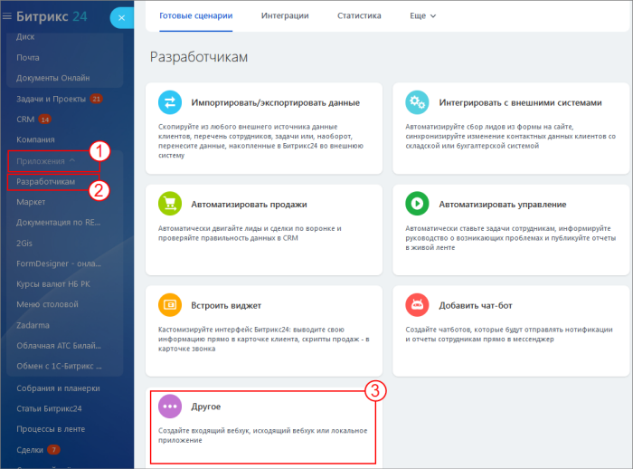
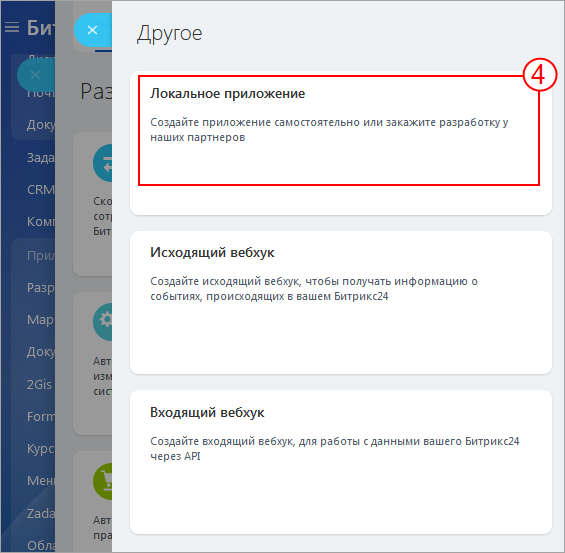
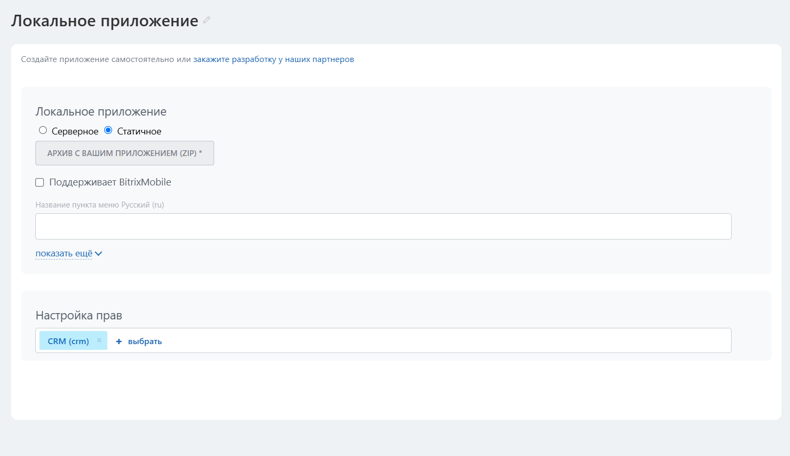
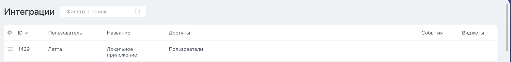

# Статичное локальное приложение



Выберите инструмент для разработки с AI-агентом:

- используйте [Битрикс24 Вайбкод](../ai-tools/vibecode.md), чтобы создать приложение для Битрикс24 по описанию задачи без знания языков программирования. Агент напишет код и разместит приложение на сервере без ручной настройки хостинга
- используйте [MCP-сервер](../ai-tools/mcp.md), чтобы разрабатывать интеграцию через REST API в своем проекте. Агент будет обращаться к официальной REST-документации



Статичное локальное приложение — это HTML-страница с JavaScript, которую Битрикс24 открывает во фрейме внутри своего интерфейса. Такой вариант подходит, если приложению нужен интерфейс в Битрикс24, но не нужен собственный сервер.

Если нужно выполнять код на своем сервере, хранить на нем секреты или получать события Битрикс24, выберите [серверное локальное приложение с пользовательским интерфейсом](./serverside-local-app-with-ui.md).



Описанный ниже способ загрузки статичного локального приложения предназначен для облачных Битрикс24.

В коробочном Битрикс24 загрузите приложение в папку файловой структуры портала и укажите эту папку в качестве пути обработчика.



## Подготовьте архив

Поместите файл `index.html` в корень ZIP-архива. Этот файл служит основной страницей приложения. CSS, JavaScript, изображения и другие файлы можно добавить в архив и подключить к `index.html` относительными путями.

Если перед первым запуском нужна настройка, добавьте в корень архива файл `install.html`. Битрикс24 откроет его как [мастер установки](../settings/app-installation/local-apps/installation-master.md).

Пример `index.html` получает имя текущего пользователя методом [user.current](../api-reference/user/user-current.md):

```html
<!doctype html>
<html lang="ru">
<head>
    <meta charset="utf-8">
    <title>Текущий пользователь</title>
    <script src="//api.bitrix24.tech/api/v1/"></script>
</head>
<body>
    <p id="user-name">Загрузка...</p>

    <script>
        BX24.init(() => {
            BX24.callMethod('user.current', {}, (result) => {
                const output = document.getElementById('user-name');

                if (result.error())
                {
                    output.textContent = 'Не удалось получить данные пользователя';
                    console.error(result.error());
                    return;
                }

                const user = result.data();
                output.textContent = [user.NAME, user.LAST_NAME]
                    .filter(Boolean)
                    .join(' ');
            });
        });
    </script>
</body>
</html>
```

Пример работает через [BX24.js](../sdk/bx24-js-sdk/index.md). Когда приложение открывается во фрейме, библиотека получает данные авторизации из окружения Битрикс24 и использует их в вызовах REST API. Поэтому в коде статичного приложения не нужно хранить вебхук, `client_secret` или OAuth-токены.

## Создайте приложение

1. Откройте *Приложения > Разработчикам > Другое > Локальное приложение*. Если пункта *Локальное приложение* нет, попросите администратора [настроить доступ к созданию приложений](./local-apps.md#local-app-access)
    

    
2. Выберите тип *Статичное*
    
3. Загрузите ZIP-архив приложения
4. Включите опцию *Поддерживает BitrixMobile*, если приложение должно работать в мобильном приложении Битрикс24
5. Укажите название пункта меню хотя бы для одного языка
6. В блоке *Настройка прав* выберите права доступа, необходимые REST-вызовам приложения
7. Нажмите *Создать*

После создания приложение появится в списке *Приложения > Разработчикам > Интеграции*.



REST-вызовы выполняются от имени сотрудника, который открыл приложение. Доступность методов ограничена правами сотрудника и правами, выбранными при создании приложения.

## Добавьте виджет {#widgets}

Статичное приложение может встраивать свои страницы в интерфейс Битрикс24 как [виджеты](../api-reference/widgets/index.md) — например, добавить вкладку в карточку компании. Обработчиком виджета служит HTML-страница из того же архива.

Для примера добавьте в архив страницу `contacts.html` и зарегистрируйте ее как вкладку карточки компании `CRM_COMPANY_DETAIL_TAB`. При создании приложения выберите права `crm` и `placement`.

### Адрес обработчика

Битрикс24 размещает все файлы архива в одной папке и сохраняет в настройках приложения только адреса `index.html` и `install.html`. Адрес другой страницы вычислите относительно страницы, которая открыта сейчас:

```js
const handler = new URL('contacts.html', location.href).href.split('?')[0];
// https://cdn-ru.bitrix24.ru/b1234567/app_local/899dc6eb61c4c5a88228db3e189b83cd/contacts.html
```

Домен и путь к папке зависят от Битрикс24, поэтому не записывайте адрес в код вручную.

### Регистрация виджета

Зарегистрируйте вкладку методом [placement.bind](../api-reference/widgets/placement-bind.md) из кода `index.html`. Вызов выполнится, если приложение открыл администратор Битрикс24 или сотрудник с правом *Кому разрешить создавать приложения для всех* — как его выдать, описано в разделе [Как настроить доступ к созданию приложений](./local-apps.md#local-app-access). Другим сотрудникам метод вернет ошибку `ACCESS_DENIED`.

```js
BX24.init(() => {
    BX24.callMethod('placement.bind', {
        PLACEMENT: 'CRM_COMPANY_DETAIL_TAB',
        HANDLER: new URL('contacts.html', location.href).href.split('?')[0],
        TITLE: 'Контакты',
    }, (result) => {
        if (result.error())
        {
            console.error(result.error());
        }
    });
});
```

Повторная регистрация того же адреса для той же точки встраивания вернет ошибку `Handler already binded`. Чтобы проверить, какие виджеты уже зарегистрированы, вызовите [placement.get](../api-reference/widgets/placement-get.md).

### Данные виджета

Код точки встраивания и ее параметры страница-обработчик получает методом [BX24.placement.info](../api-reference/widgets/ui-interaction/bx24-placement-info.md) после `BX24.init`. Читать их из тела запроса статичная страница не может.

```html
<!doctype html>
<html lang="ru">
<head>
    <meta charset="utf-8">
    <script src="//api.bitrix24.tech/api/v1/"></script>
</head>
<body>
    <p id="company">Загрузка...</p>

    <script>
        BX24.init(() => {
            const info = BX24.placement.info();
            // {"placement": "CRM_COMPANY_DETAIL_TAB", "options": {"ID": "1", ...}}
            document.getElementById('company').textContent = 'ID компании: ' + info.options.ID;
        });
    </script>
</body>
</html>
```

### Замена архива

При замене архива Битрикс24 переносит файлы в новую папку, а старую удаляет. Адреса `index.html` и `install.html` в настройках приложения обновляются автоматически. Адреса виджетов, зарегистрированные через `placement.bind`, остаются прежними и ведут на удаленные файлы — вкладка в карточке показывает ошибку 404.

После каждой замены архива перерегистрируйте виджеты:

1. Получите список виджетов методом [placement.get](../api-reference/widgets/placement-get.md)
2. Удалите виджеты со старыми адресами методом [placement.unbind](../api-reference/widgets/placement-unbind.md)
3. Зарегистрируйте их заново через `placement.bind` с адресами из новой папки

`install.html` после замены архива не открывается, потому что приложение уже установлено. Поэтому проверку удобно выполнять в `index.html` при каждом открытии: если адрес виджета не начинается с адреса текущей папки `new URL('./', location.href)`, виджет нужно перерегистрировать.

Чтобы заменить архив, откройте приложение на редактирование в списке *Приложения > Разработчикам > Интеграции*. Если форма открылась с типом *Серверное*, переключите его на *Статичное* — появится поле для загрузки архива.

## Продолжите изучение

- [{#T}](local-apps.md)
- [{#T}](../sdk/bx24-js-sdk/index.md)
- [{#T}](serverside-local-app-with-ui.md)
- [{#T}](serverside-local-app-with-no-ui.md)
