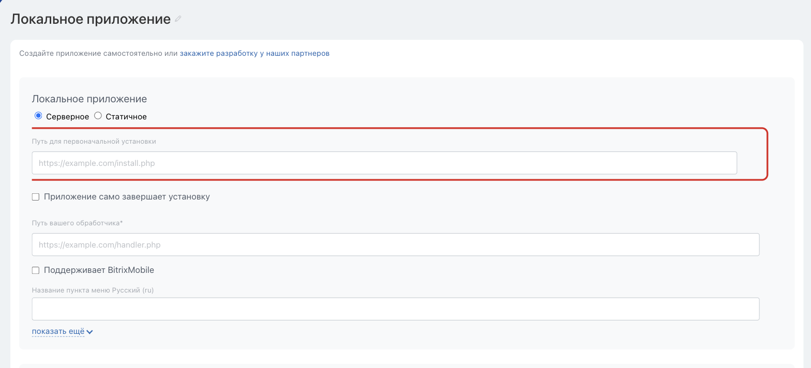
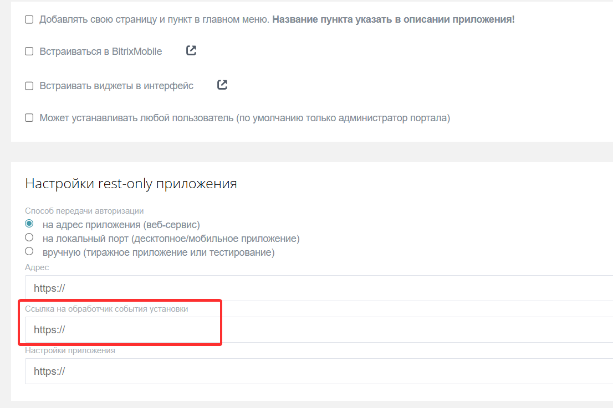
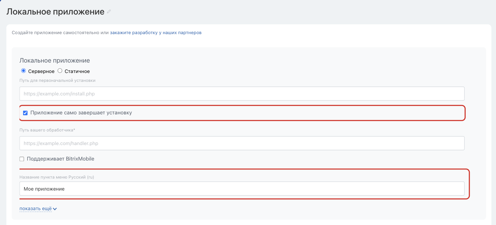
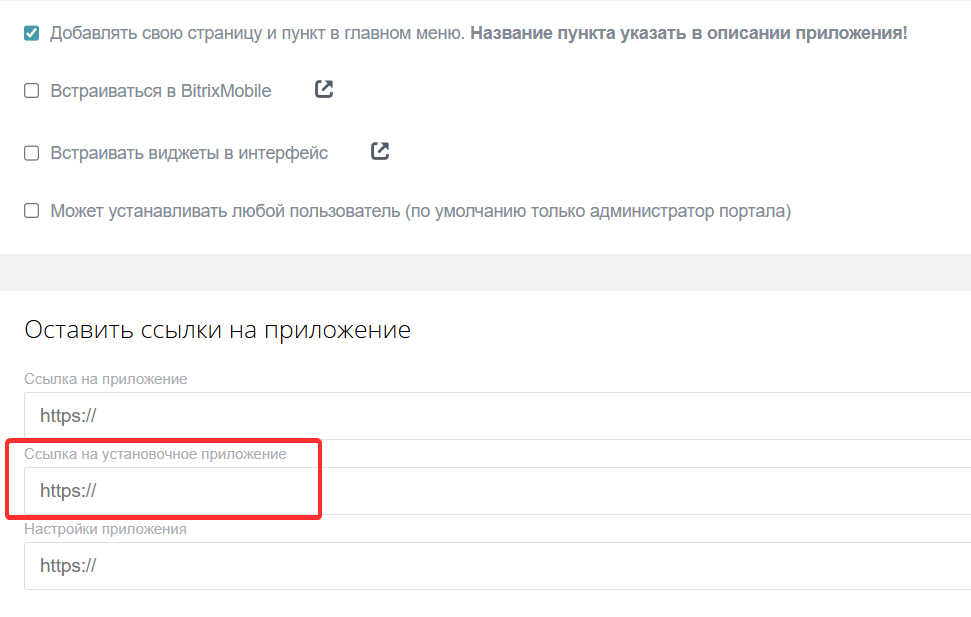

# Завершение установки приложений



Выберите инструмент для разработки с AI-агентом:

- используйте [Битрикс24 Вайбкод](../../ai-tools/vibecode.md), чтобы создать приложение для Битрикс24 по описанию задачи без знания языков программирования. Агент напишет код и разместит приложение на сервере без ручной настройки хостинга
- используйте [MCP-сервер](../../ai-tools/mcp.md), чтобы разрабатывать интеграцию через REST API в своем проекте. Агент будет обращаться к официальной REST-документации



Как завершится установка, зависит от того, есть ли у приложения мастер установки. Без мастера Битрикс24 считает приложение установленным сразу. С мастером приложение само завершает установку функцией `installFinish`, когда пользователь закончит настройку. Устанавливает приложение администратор Битрикс24 или сотрудник, которому администратор разрешил устанавливать приложения.

## Установка без мастера

Битрикс24 устанавливает приложение сам и сразу считает его установленным. Так устанавливается и приложение без интерфейса, и приложение со своей страницей, которому не нужна первоначальная настройка. Мастера нет, если:

- у локального приложения опция *Приложение само завершает установку* выключена — так по умолчанию
- у тиражного не заполнено поле *Ссылка на установочное приложение* или выключена опция *Добавлять свою страницу и пункт в главном меню*

Если указан адрес обработчика установки, Битрикс24 отправит на него POST-запрос события [ONAPPINSTALL](../../api-reference/common/events/on-app-install.md) с данными авторизации OAuth 2.0 в объекте `auth`. У локального приложения адрес задают в поле *Путь для первоначальной установки*, у тиражного — в поле *Ссылка на обработчик события установки*.





Обработчик проверяет, что запрос прислал Битрикс24, и сохраняет токены. Как это сделать, описано в статьях о callback установки [локального](./local-apps/installation-callback.md) и [тиражного](./mass-market-apps/installation-callback.md) приложения.

## Установка с мастером

Мастер установки — страница приложения, на которой администратор настраивает приложение перед началом работы. Мастер открывается, если:

- у локального приложения заполнено поле *Путь для первоначальной установки* и включена опция *Приложение само завершает установку*

   

- у тиражного включена опция *Добавлять свою страницу и пункт в главном меню* и заполнено поле *Ссылка на установочное приложение*

   

Пока страница мастера не вызовет `installFinish`, Битрикс24 считает приложение не установленным и блокирует его работу. Встройка — интерфейс приложения внутри Битрикс24, например вкладка в карточке сделки.

- встройки не появятся в интерфейсе, даже если [placement.bind](../../api-reference/widgets/placement-bind.md) завершился успешно
- события не отправятся на обработчик, даже после успешного [event.bind](../../api-reference/events/event-bind.md)
- администратор и сотрудники с правом установки увидят страницу мастера, остальные — сообщение *«Приложение еще не установлено до конца. Обратитесь к администратору вашего Битрикс24, чтобы он завершил установку»*

Проверить, завершена ли установка, можно методом [app.info](../../api-reference/common/system/app-info.md): поле `INSTALLED` в ответе равно `true` или `false`. Методу достаточно базового scope, вызвать его может любой пользователь.

## Как вызвать installFinish

Вызывайте `installFinish` на странице мастера один раз, после того как приложение выполнило настройку: зарегистрировало встройки, подписалось на события, сохранило конфигурацию. Функция работает только во фрейме приложения в браузере. После вызова Битрикс24 перезагружает страницу приложения, поэтому код после `installFinish` может не выполниться.

В примерах приложение регистрирует вкладку в карточке сделки и подписывается на событие создания сделки, затем завершает установку. Приложению нужны scope `placement` и `crm`. Замените адреса `https://example.com/...` на адреса своих обработчиков.

Если установка прервалась, перед повторной попыткой проверьте, какие встройки и обработчики уже зарегистрированы, методами [placement.get](../../api-reference/widgets/placement-get.md) и [event.get](../../api-reference/events/event-get.md).



- JS

    [installFinish()](https://bitrix-tools.github.io/b24jssdk/docs/working-with-the-rest-api/frame/#installfinish)

    ```javascript
    import { initializeB24Frame } from '@bitrix24/b24jssdk'

    const $b24 = await initializeB24Frame();

    const placement = await $b24.actions.v2.call.make({
        method: 'placement.bind',
        params: {
            PLACEMENT: 'CRM_DEAL_DETAIL_TAB',
            HANDLER: 'https://example.com/deal-tab',
            TITLE: 'Данные приложения'
        }
    });

    const event = await $b24.actions.v2.call.make({
        method: 'event.bind',
        params: {
            event: 'ONCRMDEALADD',
            handler: 'https://example.com/event-handler'
        }
    });

    if (placement.isSuccess && event.isSuccess) {
        await $b24.installFinish();
    } else {
        console.error([...placement.getErrorMessages(), ...event.getErrorMessages()]);
    }
    ```

- BX24.js

    [BX24.installFinish()](../../sdk/bx24-js-sdk/system-functions/bx24-install-finish.md)

    ```javascript
    BX24.init(function() {
        BX24.callBatch({
            placement: ['placement.bind', {
                PLACEMENT: 'CRM_DEAL_DETAIL_TAB',
                HANDLER: 'https://example.com/deal-tab',
                TITLE: 'Данные приложения'
            }],
            event: ['event.bind', {
                event: 'ONCRMDEALADD',
                handler: 'https://example.com/event-handler'
            }]
        }, function(result) {
            if (result.placement.error() || result.event.error()) {
                console.error(result.placement.error(), result.event.error());
                return;
            }

            BX24.installFinish();
        });
    });
    ```



После установки откройте приложение под сотрудником без прав администратора: интерфейс должен загрузиться, встройки — появиться в карточке сделки.

## Продолжите изучение

- [{#T}](./index.md)
- [{#T}](./local-apps/installation-master.md)
- [{#T}](./mass-market-apps/installation-master.md)
- [{#T}](../../api-reference/common/system/app-info.md)
