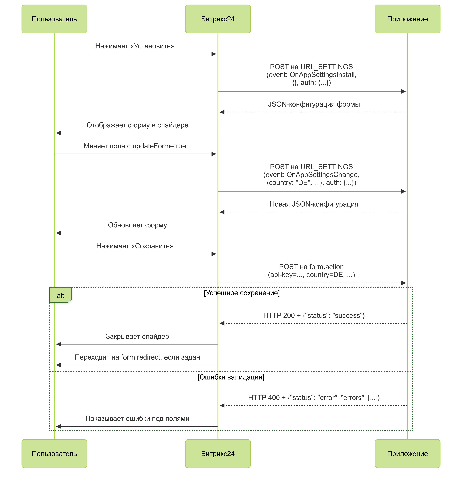

# Мастер настройки для REST-only приложений



Выберите инструмент для разработки с AI-агентом:

- используйте [Битрикс24 Вайбкод](../../../ai-tools/vibecode.md), чтобы создать приложение для Битрикс24 по описанию задачи без знания языков программирования. Агент напишет код и разместит приложение на сервере без ручной настройки хостинга
- используйте [MCP-сервер](../../../ai-tools/mcp.md), чтобы разрабатывать интеграцию через REST API в своем проекте. Агент будет обращаться к официальной REST-документации



Мастер настройки REST-only приложений — это встроенная форма Битрикс24 для тиражных приложений без интерфейса. При разработке достаточно описать поля в формате JSON. Битрикс24 сам сформирует пошаговую форму, соберет данные и отправит их в указанный обработчик. Другие варианты установки тиражного приложения сравниваются в обзоре [{#T}](./index.md).

Мастер настройки подходит, если:

- у приложения нет своего интерфейса
- нужны простые настройки: ввод текста в строку, выбор варианта из списка
- форма настроек должна выглядеть как интерфейс Битрикс24
- данных от [callback-обработчика события установки](./installation-callback.md) недостаточно

## Принцип работы мастера

Битрикс24 запрашивает форму настройки у приложения по адресу из параметра `URL_SETTINGS`. Укажите этот адрес в поле *Настройки приложения* при регистрации приложения в кабинете разработчика, в разделе REST-only. Тогда после установки приложения пользователь увидит слайдер с формой настройки.

Если `URL_SETTINGS` не заполнен, Битрикс24 не запросит конфигурацию и форма настройки не откроется.

### Жизненный цикл формы

1. Пользователь устанавливает приложение
2. Битрикс24 делает POST-запрос на `URL_SETTINGS` с параметром `event: OnAppSettingsInstall`
3. Приложение возвращает JSON-конфигурацию формы
4. Битрикс24 показывает форму в слайдере — панели, которая открывается поверх страницы Битрикс24
5. Если пользователь выбирает вариант в поле `dropdown-list` с `updateForm: true`, Битрикс24 повторно запрашивает `URL_SETTINGS` с параметром `event: OnAppSettingsChange`
6. Пользователь нажимает *Сохранить*, и данные уходят на `form.action`
7. Приложение возвращает `success` или список ошибок. После успешного сохранения Битрикс24 закрывает слайдер, а если задан `form.redirect` — вместо этого переходит по этому адресу



## Структура JSON-конфигурации

Конфигурация состоит из трех блоков:

- заголовок
- шаги с полями
- параметры сохранения

### Заголовок

Заголовок задает название страницы настроек и версию конструктора.

```json
{
  "title": "Название мастера",
  "version": "1"
}
```



#|
|| **Название**
`тип` | **Описание** ||
|| **title***
`string` | Заголовок в интерфейсе ||
|| **version**
`string` | Версия конструктора, `"1"` ||
|#

### Шаги

`steps` — массив шагов. Каждый шаг — отдельный блок формы со своим заголовком и полями.

```json
{
  "id": "step1",
  "title": "API-ключ",
  "description": "Введите ключ доступа",
  "fields": [
    {
      "id": "api-key",
      "name": "api-key",
      "type": "input",
      "label": "API-ключ",
      "placeholder": "Введите API-ключ"
    }
  ]
}
```



#|
|| **Название**
`тип` | **Описание** ||
|| **id***
`string` | Уникальный идентификатор шага ||
|| **title**
`string` | Заголовок шага ||
|| **description**
`string` | Пояснительный текст ||
|| **fields**
`array` | Массив полей шага, [подробное описание](#fields) ||
|#

#### Параметр fields {#fields}



#|
|| **Название**
`тип` | **Описание** ||
|| **id**
`string` | Идентификатор поля. Если не задан, Битрикс24 сгенерирует его сам ||
|| **name***
`string` | Имя поля, ключ в данных ||
|| **type***
`string` | Тип поля:
- `input` — строка ввода данных
- `dropdown-list` — список ||
|| **label**
`string` | Подпись над полем. Работает только у поля `input` ||
|| **placeholder**
`string` | Подсказка внутри поля. Работает только у поля `input` ||
|| **value**
`string` | Значение по умолчанию ||
|| **items**
`array` | Варианты для `dropdown-list`. Каждый вариант — объект с полями `value` — значение, которое придет в данных формы, и `name` — подпись в списке ||
|| **updateForm**
`boolean` | Флаг обновления формы при выборе варианта. Работает только у поля `dropdown-list` ||
|#

Форму можно менять, пока пользователь ее заполняет. Например, после выбора страны показать поле со списком ее регионов. Для этого задайте полю `dropdown-list` параметр `updateForm: true`: после выбора варианта Битрикс24 повторно запросит `URL_SETTINGS` и передаст в запросе текущие значения полей.

На такой запрос верните конфигурацию формы целиком. Битрикс24 строит форму заново по ответу, поэтому перенесите значения из `data` в параметры `value` полей, иначе введенные данные сбросятся.

### Параметры сохранения

Блок `form` описывает, куда отправлять данные и какие кнопки показать.

```json
{
  "form": {
    "id": "config-form",
    "action": "https://example.ru/save-handler.php",
    "clientId": "app.123...",
    "redirect": "/crm/",
    "saveCaption": "Сохранить",
    "cancelCaption": "Отмена"
  }
}
```



#|
|| **Название**
`тип` | **Описание** ||
|| **id**
`string` | Идентификатор формы ||
|| **action***
`string` | URL обработчика сохранения ||
|| **clientId***
`string` | Идентификатор приложения client_id ||
|| **redirect**
`string` | Путь внутри Битрикс24, куда перейти после успешного сохранения, например `/crm/`. Значение должно начинаться с `/` или с адреса этого Битрикс24, иначе Битрикс24 его игнорирует ||
|| **saveCaption**
`string` | Подпись кнопки «Сохранить» ||
|| **cancelCaption**
`string` | Подпись кнопки «Отмена» ||
|#

## Пример конфигурации

```json
{
  "title": "Storecove e-invoice connector",
  "version": "1",
  "steps": [
    {
      "id": "step1",
      "title": "API-ключ",
      "description": "Укажите ключ из личного кабинета Storecove",
      "fields": [
        {
          "id": "api-key",
          "name": "api-key",
          "type": "input",
          "label": "Storecove API-ключ",
          "placeholder": "Введите API-ключ"
        }
      ]
    },
    {
      "id": "step2",
      "title": "Страна",
      "fields": [
        {
          "id": "country",
          "name": "country",
          "type": "dropdown-list",
          "value": "RU",
          "items": [
            { "value": "RU", "name": "Россия" },
            { "value": "DE", "name": "Германия" },
            { "value": "US", "name": "США" }
          ],
          "updateForm": true
        }
      ]
    },
    {
      "id": "step3",
      "title": "Реквизиты компании",
      "fields": [
        {
          "id": "vat-id",
          "name": "vat-id",
          "type": "input",
          "label": "VAT ID",
          "placeholder": "Введите VAT ID"
        }
      ]
    }
  ],
  "form": {
    "id": "config-form",
    "action": "https://example.ru/save.php",
    "clientId": "app.6537665f598492.98090704",
    "redirect": "/",
    "saveCaption": "Подключить",
    "cancelCaption": "Позже"
  }
}
```

## Обработчик URL_SETTINGS

Битрикс24 запрашивает конфигурацию формы POST-запросом на `URL_SETTINGS`, если у пользователя есть доступ к приложению. Данные приходят в формате `application/x-www-form-urlencoded`, в PHP они доступны в `$_POST`. Ниже структура запросов показана в JSON для наглядности. Параметр `event` показывает, зачем пришел запрос: `OnAppSettingsInstall`, `OnAppSettingsDisplay` или `OnAppSettingsChange`. Это не отдельные события, а сценарии запроса.

В ответ на запрос приложение должно вернуть JSON-конфигурацию формы. Если ответ корректный, Битрикс24 покажет форму в интерфейсе.

### Сценарии вызова

В примерах объект `auth` сокращен.

`OnAppSettingsInstall` передается после установки приложения.

```json
{
  "event": "OnAppSettingsInstall",
  "auth": {}
}
```

`OnAppSettingsDisplay` передается, когда пользователь вручную открывает настройки из карточки приложения. Чтобы пользователь увидел текущие значения, верните конфигурацию с сохраненными настройками в `value` полей.

```json
{
  "event": "OnAppSettingsDisplay",
  "auth": {}
}
```

`OnAppSettingsChange` передается, когда пользователь изменяет значение поля с параметром `updateForm: true`. В запросе дополнительно передается объект `data` с текущими значениями полей.

```json
{
  "event": "OnAppSettingsChange",
  "data": {
    "api-key": "cc1107f4-...",
    "country": "DE"
  },
  "auth": {}
}
```

Пример POST-запроса в PHP:

```php
[
  'event' => 'OnAppSettingsInstall', // или OnAppSettingsChange / OnAppSettingsDisplay
  'data'  => [ /* текущие значения полей */ ],
  'auth'  => [
    'access_token' => '***',
    'expires' => 1768385511,
    'expires_in' => 3600,
    'scope' => 'crm,bizproc,appform,user_brief,placement,catalog',
    'domain' => 'some-domain.bitrix24.ru',
    'server_endpoint' => 'https://oauth.bitrix24.tech/rest/',
    'status' => 'F',
    'client_endpoint' => 'https://some-domain.bitrix24.ru/rest/',
    'member_id' => '***',
    'refresh_token' => '***',
    'user_id' => 431,
    'client_id' => '***',
    'application_token' => '***'
  ]
]
```

#|
|| **Название**
`тип` | **Описание** ||
|| **event**
`string` | Сценарий запроса:
- `OnAppSettingsInstall` — после установки приложения
- `OnAppSettingsDisplay` — при открытии настроек приложения
- `OnAppSettingsChange` — при изменении поля с `updateForm: true` ||
|| **data**
`object` | Текущие значения полей формы. Передается для `OnAppSettingsChange` ||
|| **auth**
`object` | Данные авторизации ||
|#

## Обработчик после сохранения

Когда пользователь нажимает *Сохранить*, Битрикс24 отправляет данные формы на адрес из поля `form.action`.

```php
$_POST = [
  'data' => [
    'api-key' => 'cc1107f4-...',
    'country' => 'DE',
    // остальные поля по имени (name)
  ],
  'auth' => [
    // данные авторизации, как в запросе на URL_SETTINGS
  ]
];
```

Поля `input`, которые пользователь оставил пустыми, в `data` не передаются.

Пример чтения данных:

```php
$data = $_POST['data'] ?? [];
$apiKey = $data['api-key'] ?? null;
$country = $data['country'] ?? null;
```

### Успешный ответ

Битрикс24 считает данные сохраненными, если обработчик вернул корректный JSON с HTTP-статусом 200. Поле `status` Битрикс24 не проверяет. После успешного сохранения слайдер закрывается, а если задан параметр `form.redirect` — Битрикс24 вместо этого переходит по этому адресу.

```php
http_response_code(200);
header("Content-Type: application/json");
echo json_encode(['status' => 'success']);
```

### Ответ с ошибками

Если данные некорректны, верните HTTP-статус не 200, например 400, и массив `errors`. В каждой ошибке укажите в `field` значение `name` поля из конфигурации. Ошибку без `field` форма не покажет. Если массив `errors` пуст, Битрикс24 посчитает сохранение успешным даже при статусе не 200.

```php
http_response_code(400);
header("Content-Type: application/json");
echo json_encode([
  'status' => 'error',
  'errors' => [
    ['field' => 'api-key', 'message' => 'Неверный формат API-ключа'],
    ['field' => 'country', 'message' => 'Страна обязательна']
  ]
]);
```

Битрикс24 показывает ошибки под соответствующими полями. Можно вернуть несколько ошибок для одного поля.

#### Пример обработчика для возврата статуса

Для примера нужны функция `loadApplicationToken()` вашего хранилища и каталог `/var/app-data` с правом записи для PHP.

Перед сохранением обработчик проверяет, что запрос пришел от Битрикс24: сравнивает `auth.application_token` с токеном, который приложение сохранило для этого `member_id` при установке. Форма открывается уже после установки, поэтому токен к этому моменту должен быть сохранен. Если его нет, запрос отклоните. Как получить и хранить токен, описано в статье [{#T}](../../../api-reference/events/safe-event-handlers.md).

```php
<?php
$data = $_POST['data'] ?? [];
$auth = $_POST['auth'] ?? [];
$memberId = (string)($auth['member_id'] ?? '');

// application_token, сохраненный при установке приложения для этого Битрикс24
$savedToken = loadApplicationToken($memberId); // функция вашего хранилища

if ($savedToken === '' || !hash_equals($savedToken, (string)($auth['application_token'] ?? '')))
{
    http_response_code(403);
    exit();
}

if (($data['api-key'] ?? null) === 'error')
{
    http_response_code(400);
    header("Content-Type: application/json");

    echo json_encode([
        'status' => 'error',
        'errors' => [
            [
                'field' => 'api-key',
                'message' => 'You input invalid value',
            ],
            [
                'field' => 'api-key',
                'message' => 'You input invalid value 2',
            ],
        ],
    ]);
    exit();
}

// храните настройки отдельно для каждого Битрикс24, вне публичного каталога сайта
if (file_put_contents('/var/app-data/settings-' . md5($memberId) . '.json', json_encode($data)) === false)
{
    http_response_code(500);
    header("Content-Type: application/json");
    echo json_encode(['status' => 'error', 'errors' => [['field' => 'api-key', 'message' => 'Cannot save settings']]]);
    exit();
}

http_response_code(200);
header("Content-Type: application/json");
echo json_encode(['status' => 'success']);
exit();
?>
```

## Устаревший способ показа формы

Метод `appform.show` устарел. Он открывает форму через push-событие `showForm`. Основной способ — автоматический запрос к `URL_SETTINGS` после установки приложения.

Ограничения `appform.show`:

- нужна активная сессия пользователя в Битрикс24, иначе событие теряется
- нужен `access_token` для вызова от имени пользователя

## Продолжите изучение

- [{#T}](./index.md)
- [{#T}](./installation-callback.md)
- [{#T}](./installation-master.md)
- [{#T}](../../oauth/index.md)
